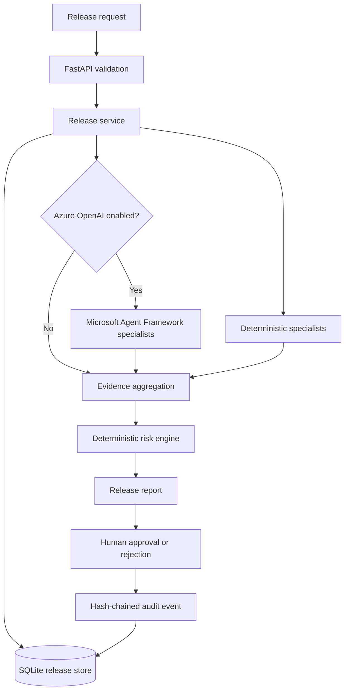

# Architecture

The current application is a local-first Python service with an optional hosted
LLM analysis mode.

1. FastAPI validates a release submission with Pydantic.
2. The release service runs four deterministic specialists in bounded parallel
   execution. In optional Azure mode, it also runs four Microsoft Agent
   Framework specialists against sanitised evidence.
3. Specialist findings are validated and aggregated. LLM findings must cite
   exact supplied evidence and a changed-file path.
4. When RAG is enabled, each hosted specialist retrieves relevant version-controlled policy chunks from Azure AI Search using Azure OpenAI embeddings. Returned policy references are validated against that retrieval result; release evidence is validated independently.\n5. The deterministic risk engine computes the weighted score; model output
   cannot directly set a score or release decision.
6. A release record is persisted in SQLite. Creation and human decisions append
   hash-chained audit events.
7. Human approval/rejection remains an explicit API action.

## Current limitations

- Azure OpenAI mode is optional and requires an Azure deployment and credentials.
  It sends sanitised release snippets to that configured resource.
- Model findings are advisory and evidence-validated; no model has tools or
  permission to execute source, modify GitHub, or approve a release.
- SQLite is intended for local development; production should use managed
  storage, backups and restricted access.
- The API still lacks production authentication/authorisation and rate limits.
- RAG, Azure AI Search, C# ASP.NET Core, Azure Functions, frontend and cloud
  deployment are not yet implemented.
- Local pattern checks may produce false positives and are not a substitute for
  dedicated scanners or professional code review.
