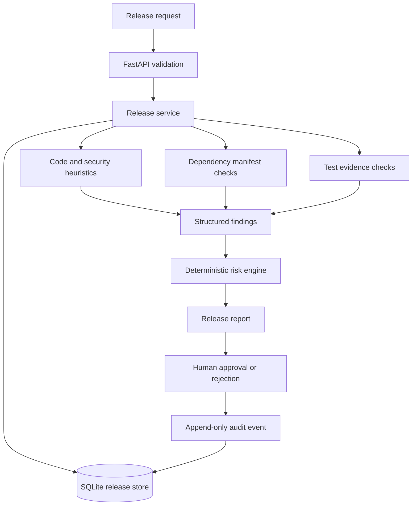

# Architecture

The current MVP is a synchronous, local-first Python service.

1. FastAPI validates a release submission with Pydantic.
2. The release service runs bounded local analyzers on submitted patch text and metadata.
3. Findings are aggregated by a deterministic risk engine.
4. A release record is persisted in SQLite and returned with a checklist and rollback plan.
5. Release creation and human decisions append hash-chained audit events in the same database transaction.
6. A human decision can be recorded through approve/reject endpoints and reviewed through the audit API.

## Current limitations

- SQLite is intended for local development; production should use a managed database and backup/restore strategy.
- No live GitHub integration, webhook receiver, Azure resource, hosted LLM or deployment integration is implemented.
- Pattern checks may produce false positives and are not a substitute for Semgrep, OSV-Scanner or professional code review.
- The API currently has no authentication, authorisation or rate limiting. The local SQLite audit log is tamper-evident but not tamper-proof against database administrators. It is a development prototype and should not be exposed publicly.
