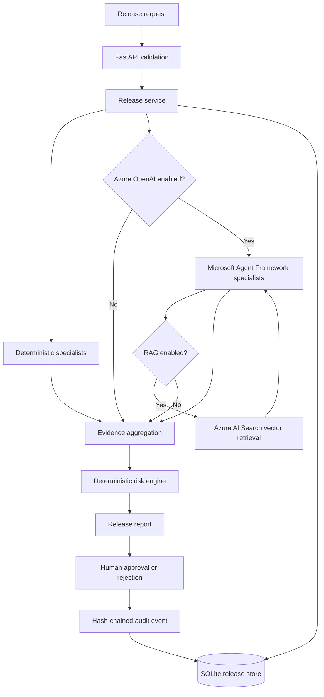

# Architecture

The current application is a local-first Python service with optional hosted
LLM analysis and policy retrieval.

1. FastAPI validates a release submission with Pydantic.
2. The release service runs four deterministic specialists concurrently. In
   Azure mode, it also runs four Microsoft Agent Framework specialists.
3. When RAG is enabled, each hosted specialist retrieves relevant policy chunks
   from Azure AI Search using embeddings generated by Azure OpenAI.
4. AI findings must cite exact supplied release evidence. Policy references are
   validated against the retrieved chunk IDs for that specialist.
5. The deterministic risk engine computes the weighted score; model output
   cannot directly set a score or release decision.
6. A release record is persisted in SQLite. Creation and human decisions append
   hash-chained audit events.
7. Human approval/rejection remains an explicit API action.

## Current limitations

- Azure OpenAI and RAG modes are optional and require configured Azure
  deployments, credentials and service resources.
- RAG currently uses a curated Markdown corpus and vector nearest-neighbour
  retrieval; hybrid search, semantic reranking and automatic source ingestion
  are not implemented.
- Model findings are advisory and evidence-validated; no model has tools or
  permission to execute source, modify GitHub, or approve a release.
- SQLite is intended for local development; production should use managed
  storage, backups and restricted access.
- The API still lacks production authentication/authorisation and rate limits.
- C# ASP.NET Core, Azure Functions, frontend and cloud deployment remain planned.
- Local pattern checks may produce false positives and are not a substitute for
  dedicated scanners or professional code review.
