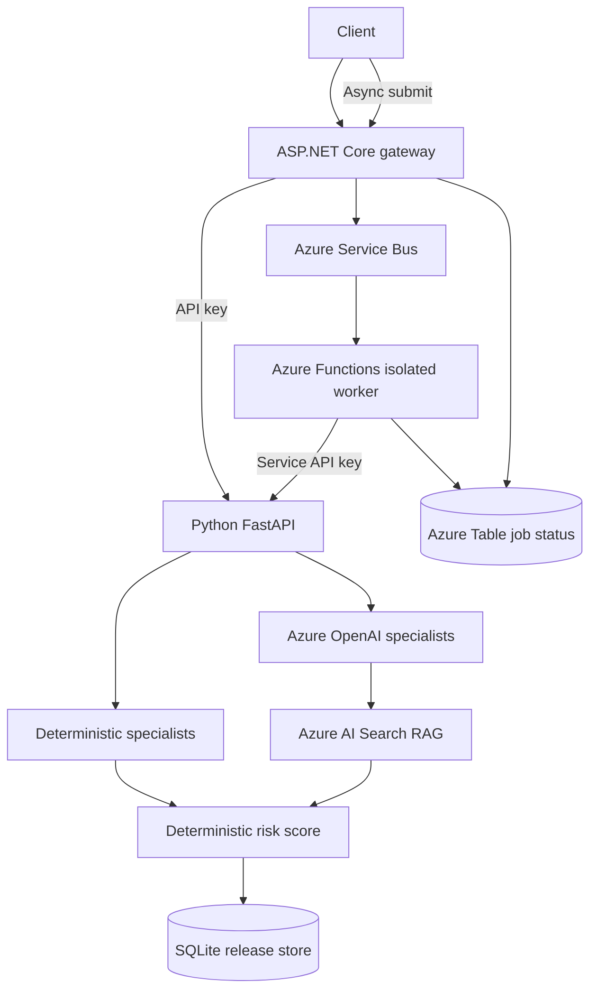

# Architecture

ReleaseGuard is a local-first Python analysis service with optional hosted AI,
retrieval, and .NET cloud integration components.

## Synchronous analysis path

1. A client submits a release request to the ASP.NET Core gateway or directly
   to the private Python FastAPI service.
2. The gateway checks its API key and forwards the request to Python. When
   `RELEASEGUARD_API_KEY` is configured, Python validates the forwarded
   `X-API-Key` using constant-time comparison.
3. The Python release service runs four deterministic specialists. In Azure
   mode, it also runs four Microsoft Agent Framework specialists.
4. When RAG is enabled, each hosted specialist retrieves policy chunks from
   Azure AI Search using embeddings generated by Azure OpenAI.
5. AI findings must cite exact supplied release evidence. Policy references are
   validated against retrieved chunk IDs.
6. The deterministic risk engine calculates the weighted score. Model output
   cannot directly set a score or release decision.
7. The release record is persisted in SQLite. Creation and human decisions
   append hash-chained audit events. Human approval/rejection remains explicit.

## Asynchronous analysis path

1. An authenticated caller submits a release request to the gateway's
   `POST /api/jobs` endpoint.
2. The gateway creates a queued status row in Azure Table Storage and publishes
   a message to the configured Azure Service Bus queue.
3. The .NET 10 Azure Functions isolated worker consumes the message and marks
   the job as processing.
4. The worker calls the private Python `POST /api/releases` endpoint with the
   service-to-service API key.
5. On success, the worker stores the resulting Python `release_id` and marks
   the job completed. Callers poll `GET /api/jobs/{jobId}` for status.

## Current limitations

- Azure OpenAI, Azure AI Search, Service Bus and Table Storage require configured
  resources. Cloud end-to-end behaviour is not verified by source-only CI.
- The .NET gateway uses API keys as a starter boundary. Production should use
  Microsoft Entra ID, managed identities, role-based authorisation and Key Vault.
- Service Bus is at-least-once. The Python create endpoint does not yet accept
  an idempotency key, so a retry after a successful backend write but before
  status persistence can create a duplicate assessment.
- RAG currently uses a curated Markdown corpus and vector nearest-neighbour
  retrieval; hybrid search, semantic reranking and automatic source ingestion
  are not implemented.
- The benchmark corpus is synthetic. No model accuracy, latency or cost claim
  is valid until a predictions file is measured against representative labels.
- SQLite is intended for local development; production should use managed
  storage, backups and restricted access.
- Local pattern checks can produce false positives and are not a substitute
  for dedicated scanners or professional code review.
